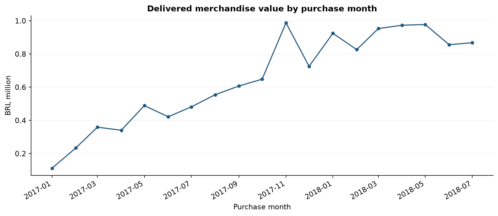

# Marketplace Performance & Customer Experience Analysis

End-to-end анализ исторического маркетплейса Olist: PostgreSQL → Python → Excel → бизнес-рекомендации.

**Период отчёта:** покупки с 01.01.2017 по 31.07.2018. Полная исходная история сохранена отдельно.
**Стек:** PostgreSQL 18, Python 3.12, pandas, NumPy, matplotlib, SciPy, Excel.
**Источник:** [Brazilian E-Commerce Public Dataset by Olist](https://www.kaggle.com/datasets/olistbr/brazilian-ecommerce), CC BY-NC-SA 4.0.

## Задача

Оценить динамику продаж, различия регионов и качество доставки.
Проверить связь опоздания с низкими оценками, подготовить проверяемые рекомендации.
Это исторический учебный бизнес-кейс, а не анализ текущего бизнеса Olist.

## Результаты

- 92 580 заказов в отчётном периоде, 89 860 доставленных.
- Стоимость товаров в доставленных заказах: **12 342 450,49 BRL**, средний чек товаров **137,35 BRL**.
- Опоздали **6 138 из 89 852** пригодных заказов: **6,83%**.
- Восемь delivered-заказов без фактической даты исключены только из метрик доставки.
- В основной статистической выборке низкие оценки встречаются у **63,81%** опоздавших против **9,38%** своевременных заказов.
- Разность **54,43 п.п.** существенно чувствительна к времени отзыва: среди ответов после получения — **10,54 п.п.** Это наблюдательная связь, не доказанный причинный эффект.
- 14 независимых сверок SQL с исходными CSV прошли, включая денежные суммы по каждому заказу.

GMV не равно выручке Olist или прибыли. Не заявляется фактическое улучшение бизнес-показателей.



## Что открыть

1. [Бизнес-отчёт](reports/business_report.md) — результаты, рекомендации и ограничения.
2. [Excel-дашборд](reports/marketplace_dashboard.xlsx) — фильтры штата и периода, формульные сводки, четыре редактируемых графика.
3. [Ноутбук EDA](notebooks/02_marketplace_analysis.ipynb).
4. [Статистическая проверка](notebooks/03_statistical_analysis.ipynb).
5. [Метрики](docs/metrics.md), [схема](docs/schema.md), [порядок разбора](docs/walkthrough.md).

## Структура

```text
data/                  9 исходных CSV, не включаются в Git
sql/                   схема, загрузка, проверки, витрины и бизнес-запросы
scripts/               воспроизводимый Python-пайплайн и сборка отчётов
notebooks/             3 выполненных ноутбука с пояснениями и результатами
exports/               снимки витрин PostgreSQL, генерируются заново
reports/
  business_report.md   выводы и рекомендации
  marketplace_dashboard.xlsx
  statistics.json      тест, размеры групп, интервалы и чувствительность
  validation.json      результаты независимых сверок
  source_manifest.json SHA-256 исходных CSV
  figures/             графики
  tables/              агрегированные результаты
  data_understanding/  первичное обследование
docs/                  определения, схема, разбор, воспроизведение
```

## Быстрый запуск в текущем проекте

Запускай из корня проекта в терминале PyCharm. pgAdmin закрывать можно: нужна работающая служба PostgreSQL.

```powershell
.\.venv\Scripts\python.exe -m pip install -r requirements.txt
.\.venv\Scripts\python.exe scripts/refresh_from_postgres.py
.\.venv\Scripts\python.exe scripts/build_analysis.py
```

Обновление из PostgreSQL запросит пароль, если PGPASSWORD не задан.
По умолчанию: 127.0.0.1:5432, база olist, пользователь postgres.
Переопределение через PGHOST, PGPORT, PGDATABASE, PGUSER, PGPASSWORD.
Пароль не сохраняется в коде и не должен попадать в Git.

Если уже есть exports/, Python-анализ можно повторить без подключения к базе:
```powershell
.\.venv\Scripts\python.exe scripts/build_analysis.py
```

## Запуск с нуля

1. Установи PostgreSQL, создай пустую базу olist. Команду CREATE DATABASE запускай отдельно от транзакций.
2. Получи девять CSV по ссылке источника и положи в data/. Исходные файлы не включены в архив.
3. Создай Python-окружение и установи зависимости:
```powershell
python -m venv .venv
.\.venv\Scripts\python.exe -m pip install -r requirements.txt
```
4. Загрузи raw-таблицы клиентским COPY:
```powershell
.\.venv\Scripts\python.exe scripts/load_database.py
```
Загрузчик проверяет заголовки и количество записей, сохраняет исходные NULL и дубликаты.
Непустые таблицы с ожидаемым числом строк пропускаются. Это проверка количества, не хеша содержимого.
Неожиданное количество останавливает транзакцию без удаления данных.

5. Обследование и анализ:
```powershell
.\.venv\Scripts\python.exe data_understand.py
.\.venv\Scripts\python.exe scripts/refresh_from_postgres.py
.\.venv\Scripts\python.exe scripts/build_analysis.py
```

6. Открой ноутбуки в PyCharm/Jupyter и выбери .venv. Для автоматического выполнения:
```powershell
.\.venv\Scripts\python.exe -m ipykernel install --user --name olist
$env:OLIST_KERNEL = "olist"
.\.venv\Scripts\python.exe scripts/make_notebooks.py
```
Ноутбуки в поставке уже выполнены. Скрипт обновит их и пересчитает встроенные результаты.

## Работа с SQL

В pgAdmin Query Tool выбирай базу olist и запускай файлы отдельно:
- 01_create_tables.sql — схема raw и таблицы.
- 02_load_data.sql — загрузка по текущему локальному пути D:/data_analyst/project1/data.
- 03_check_load.sql — сверка количества строк.
- 04_quality_checks.sql — проверки и результаты первоначального контроля.
- 05_analytics_views.sql — аналитический слой.
- 06_business_analysis.sql — шесть бизнес-запросов с CTE и окнами.
- 07_export_data.sql — серверный экспорт для текущего локального пути.

**Для другой папки или сервера используй Python-загрузчик и refresh_from_postgres.py:** они работают через клиентский COPY и не требуют доступа службы PostgreSQL к локальным папкам.
Не объединяй все SQL-файлы в один запрос: у отдельных файлов есть собственные границы транзакций.

## Excel

На Dashboard жёлтые поля задают штат, первый и последний месяц.
Monthly и показатели Dashboard пересчитываются; Regions сравнивает все штаты выбранного периода.
Categories показывает весь базовый период и явно не зависит от фильтров Dashboard.
Data содержит агрегаты месяц × штат. Доли вычисляются из сумм числителей и знаменателей, а не усреднением процентов.

Книга содержит формульные сводки SUMIFS, таблицу с автофильтром, валидацию выбора, условное форматирование и четыре native Excel charts.
Это не live-подключение к БД. Чтобы обновить входные агрегаты, выполни Python-пайплайн и пересобери книгу.

Сборщик scripts/build_dashboard.mjs использует @oai/artifact-tool из среды Codex и Node.js.
Для повторной сборки в Codex задай ARTIFACT_NODE_MODULES, указывающий на bundled node_modules, затем:
```powershell
node scripts/build_dashboard.mjs
```
Вне Codex готовая книга работает в Excel самостоятельно; библиотека сборки для её использования не требуется.
Формулы и выбор фильтров проверены в движке Artifact Tool, native-графики и отсутствие формульных ошибок проверены в XLSX.
Работа именно в настольном Excel в этой сессии не проверялась.

## Проверки

- Сохранены все исходные заказы: 99 441 строка витрины и столько же уникальных order_id.
- Денежные суммы позиций, доставки и оплат сверены с raw в PostgreSQL.
- Python независимо пересчитывает суммы каждого заказа из CSV и сверяет с SQL.
- Проверены выбор отзыва, итоги по месяцам и категориям и календарное правило опоздания.
- Все ноутбуки выполнены без ошибок.
- В Excel проверены ALL, SP, отдельный месяц и неверный диапазон дат.

## Ограничения

- Нет себестоимости, комиссий, населения регионов и достаточной информации о возвратах.
- Выгрузка историческая; полнота покрытия рынка неизвестна.
- Отзывы — отобранная подвыборка, часть ответов написана до получения.
- Одно наблюдение на покупателя не устраняет зависимость по продавцам и времени.
- Статистическое различие не даёт причинного эффекта и не позволяет обещать ROI.
- Исходные данные и order-level экспорты не включаются в Git. Результаты относятся к файлам с хешами из manifest.
- Репозиторий: [olist-marketplace-analytics](https://github.com/AzatBadretdinov/olist-marketplace-analytics).

## Авторство и обучение

Первая полная реализация подготовлена с помощью ИИ по запросу владельца проекта.
Перед использованием в резюме нужно самостоятельно разобрать и воспроизвести код.
Для этого есть docs/walkthrough.md. Не следует приписывать себе проведённые эксперименты или бизнес-эффект, которых не было.


