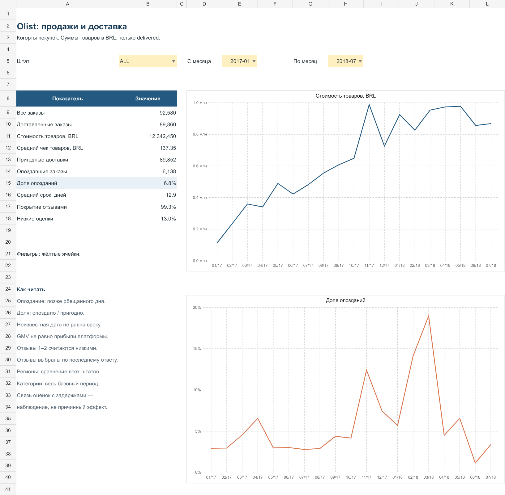
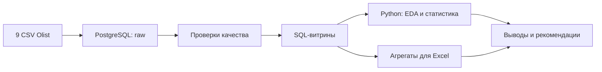

<div align="center">

# Olist Marketplace Analytics

**Продажи · Доставка · Клиентский опыт**

Аналитический проект на данных бразильского маркетплейса Olist — от загрузки CSV в PostgreSQL до статистических выводов и Excel-дашборда.


[Бизнес-отчёт](reports/business_report.md) · [Анализ данных](notebooks/02_marketplace_analysis.ipynb) · [Статистика](notebooks/03_statistical_analysis.ipynb) · [Excel-дашборд](reports/marketplace_dashboard.xlsx)

</div>

---

## О проекте

Как меняются продажи маркетплейса? В каких регионах доставка требует внимания? Как опоздания связаны с оценками покупателей?

Проект исследует эти вопросы на девяти связанных таблицах Olist. Основной отчёт охватывает **январь 2017 — июль 2018**; вся исходная история сохраняется в базе. Это исторический аналитический кейс: результаты относятся к наблюдаемой выгрузке.

## Результаты в цифрах

| Показатель | Значение |
| :--- | ---: |
| Заказы в отчётном периоде | **92 580** |
| Доставленные заказы | **89 860** |
| Стоимость товаров в доставленных заказах | **12,34 млн BRL** |
| Средний чек товаров | **137,35 BRL** |
| Опоздавшие заказы / пригодные для оценки доставки | **6 138 / 89 852** |
| Доля опозданий | **6,83%** |

> Стоимость товаров (GMV) рассчитана без доставки. Она не равна выручке платформы или прибыли. Восемь доставленных заказов без фактической даты получения исключены из метрик доставки.

## Дашборд

Выбор штата и периода пересчитывает показатели и помесячные графики. Региональная таблица помогает сравнить долю опозданий с объёмом заказов.

<p align="center">
  
</p>

**[Скачать Excel-отчёт](reports/marketplace_dashboard.xlsx)**

## Что показал анализ

- **Продажи выросли в сопоставимых календарных периодах.** Стоимость товаров доставленных заказов за январь–июль 2018 выше января–июля 2017 на **161,6%**. Покрытие выгрузки могло меняться, поэтому этот результат не интерпретируется как доказанный органический рост.
- **Объём проблем и частота проблем дают разные приоритеты.** В SP больше всего опозданий в абсолютном выражении. В RJ доля опозданий составляет **12,5%** при **11 587** пригодных заказах, что делает регион кандидатом для дальнейшего разбора маршрутов и продавцов.
- **Опоздания связаны с низкими оценками, но величина связи чувствительна к выборке.** В основной выборке низкие оценки встречаются у **63,81%** опоздавших и **9,38%** своевременных заказов. Разность **54,43 п.п.** уменьшается до **10,54 п.п.**, если оставить только отзывы после фактического получения. Это наблюдательная связь, не причинный эффект.

Подробные рекомендации, доверительные интервалы и ограничения собраны в **[бизнес-отчёте](reports/business_report.md)**.

## Как устроен анализ



| Этап | Что сделано |
| :--- | :--- |
| **Данные** | Структура девяти CSV, ключи, пропуски, дубликаты и связи |
| **PostgreSQL** | Загрузка, контроль качества, витрина с одной строкой на заказ, CTE и оконные функции |
| **Python** | Независимая сверка SQL с CSV, анализ динамики, регионов и категорий, шесть графиков |
| **Статистика** | Сравнение долей, интервалы Wilson и Newcombe, анализ чувствительности |
| **Excel** | Фильтры, формулы SUMIFS, условное форматирование и четыре редактируемых графика |

Позиции и оплаты агрегируются **до соединения** с заказами. При нескольких отзывах выбирается последний по времени ответа. Эти решения защищают суммы от удвоения и делают расчёты воспроизводимыми.

## Навигация по проекту

| Материал | Содержание |
| :--- | :--- |
| [Бизнес-отчёт](reports/business_report.md) | Результаты, приоритеты, рекомендации и ограничения |
| [Обследование данных](notebooks/01_data_understanding.ipynb) | Структура, пропуски и ключи |
| [Анализ маркетплейса](notebooks/02_marketplace_analysis.ipynb) | Продажи, доставка, регионы и категории |
| [Статистическая проверка](notebooks/03_statistical_analysis.ipynb) | Гипотеза, эффект, интервалы и чувствительность |
| [SQL-запросы](sql/06_business_analysis.sql) | Шесть бизнес-вопросов и расчёты |
| [Определения метрик](docs/metrics.md) | Популяции, формулы, знаменатели и исключения |
| [Схема данных](docs/schema.md) | Связи исходных таблиц и аналитический слой |
| [Воспроизведение](docs/reproducibility.md) | Зависимости и проверки |
| [Руководство по разбору](docs/walkthrough.md) | Порядок изучения и вопросы для защиты проекта |

## Быстрый старт

Нужны **Python 3.12**, **PostgreSQL** и девять CSV из [исходного датасета](https://www.kaggle.com/datasets/olistbr/brazilian-ecommerce). Команды ниже предназначены для PowerShell и запускаются из корня проекта.

### 1. Подготовить окружение и данные

```powershell
python -m venv .venv
.\.venv\Scripts\python.exe -m pip install -r requirements.txt
```

Распакуй CSV в `data/` и создай пустую базу `olist` в PostgreSQL. Инструкция по файлам — в [data/README.md](data/README.md).

### 2. Загрузить данные и построить отчёт

```powershell
.\.venv\Scripts\python.exe scripts/load_database.py
.\.venv\Scripts\python.exe data_understand.py
.\.venv\Scripts\python.exe scripts/refresh_from_postgres.py
.\.venv\Scripts\python.exe scripts/build_analysis.py
```

По умолчанию подключение идёт к `127.0.0.1:5432`, базе `olist`, от имени `postgres`. Пароль запрашивается при запуске. Настройки можно изменить через `PGHOST`, `PGPORT`, `PGDATABASE`, `PGUSER` и `PGPASSWORD`; пароль не хранится в коде.

Если выгрузки в `exports/` уже готовы, достаточно последней команды: Python-анализ можно повторить без подключения к базе.

<details>
<summary><strong>SQL, выполнение ноутбуков и обновление Excel</strong></summary>

### SQL

Запускай файлы по отдельности в Query Tool базы `olist`:

| Файл | Назначение |
| :--- | :--- |
| `01_create_tables.sql` | Схема raw и таблицы |
| `02_load_data.sql` | Загрузка CSV по локальному пути |
| `03_check_load.sql` | Проверка количества строк |
| `04_quality_checks.sql` | Контроль ключей, связей и значений |
| `05_analytics_views.sql` | Аналитические представления |
| `06_business_analysis.sql` | Бизнес-запросы |
| `07_export_data.sql` | Серверная выгрузка |

В файлах 02 и 07 указан текущий путь Windows. Для другой папки или сервера используй Python-загрузчик и `refresh_from_postgres.py`: клиентский COPY не требует доступа службы PostgreSQL к локальным папкам. Файлы имеют собственные границы транзакций — не объединяй их в один запрос.

### Ноутбуки

Все три ноутбука сохранены с выполненными ячейками. Для повторного выполнения выбери окружение `.venv` в редакторе или запусти:

```powershell
.\.venv\Scripts\python.exe -m ipykernel install --user --name olist
$env:OLIST_KERNEL = "olist"
.\.venv\Scripts\python.exe scripts/make_notebooks.py
```

### Excel

- **Dashboard** — показатели, штат и границы периода.
- **Monthly** — помесячные расчёты выбранного штата.
- **Regions** — все штаты выбранного периода.
- **Categories** — весь базовый период; фильтры Dashboard не применяются.
- **Data** — агрегаты месяц × штат.

Доли вычисляются из сумм числителей и знаменателей. Книга работает самостоятельно и не подключена к базе напрямую. Для обновления источников повтори Python-пайплайн. Дополнительная сборка книги описана в [инструкции воспроизведения](docs/reproducibility.md).

</details>

## Контроль качества

**14 независимых сверок SQL с исходными CSV** прошли успешно. В том числе проверены:

- одна строка на заказ: **99 441** строка витрины и столько же уникальных `order_id`;
- суммы товаров, доставки и оплат **по каждому заказу**;
- выбор последнего отзыва и итоги по месяцам и категориям;
- календарное правило опоздания и исключение неизвестных дат.

Ноутбуки выполнены без ошибок. Формулы Excel проверены в режимах ALL и SP, для отдельного месяца и неверного диапазона. В XLSX проверены графики и отсутствие ошибок формул; в настольном Excel книга в этой сессии не открывалась.

## Структура репозитория

```text
├── data/                  # Исходные CSV: скачиваются отдельно
├── sql/                   # Загрузка, проверки, витрины и анализ
├── scripts/               # Python-пайплайн и сборка отчётов
├── notebooks/             # Три выполненных ноутбука
├── exports/               # Генерируемые выгрузки PostgreSQL
├── reports/
│   ├── business_report.md
│   ├── marketplace_dashboard.xlsx
│   ├── figures/           # Шесть аналитических графиков
│   ├── tables/            # Результирующие таблицы
│   └── data_understanding/
├── docs/                  # Метрики, схема и воспроизведение
├── requirements.txt
└── requirements-lock.txt
```

## Ограничения и источник

Нет данных о себестоимости, комиссиях, населении регионов и достаточных сведений о возвратах. Отзывы представляют отобранную выборку, а часть ответов дана до получения заказа. Один заказ на покупателя не устраняет зависимость по продавцам и времени. Результаты не используются для обещания причинного эффекта или ROI.

Данные предоставлены **Olist**: [Brazilian E-Commerce Public Dataset](https://www.kaggle.com/datasets/olistbr/brazilian-ecommerce), лицензия **CC BY-NC-SA 4.0**. Исходные CSV и выгрузки уровня заказа исключены из Git. Хеши использованных файлов сохранены в [source_manifest.json](reports/source_manifest.json).

