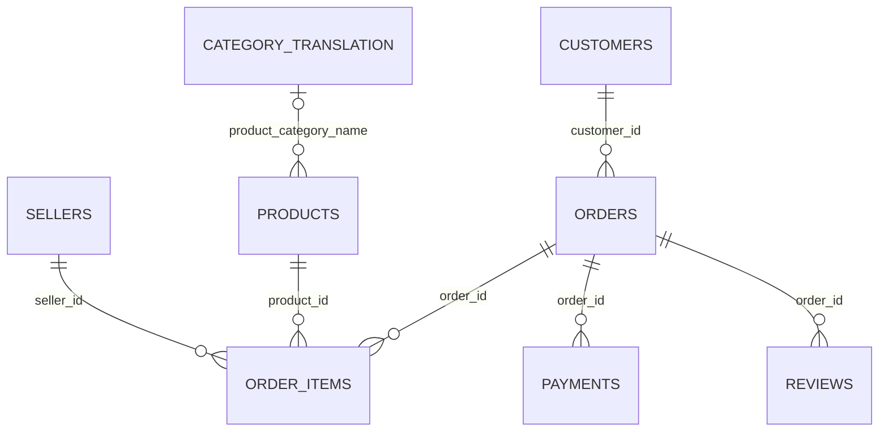

# Схема данных

Диаграмма показывает предполагаемые логические связи, не физические FOREIGN KEY в raw.
В этой выгрузке orders/customer_id связан 1:1 с customers/customer_id.
customer_unique_id может повторяться и используется для идентификации покупателя.
order_items: составной ключ (order_id, order_item_id).
payments: кандидат (order_id, payment_sequential).
reviews: кандидат (review_id, order_id); order_id может повторяться.
geolocation: несколько записей на почтовый префикс, естественный ключ не назначен.

Подробный автоматически сформированный словарь исходных столбцов:
../reports/data_understanding/data_dictionary.md.

## Аналитический слой

- analytics.order_fact — вся история, одна строка на заказ; покупатель, суммы, выбранный отзыв, флаги доставки.
- analytics.monthly_state — месяц покупки × штат, только основной период.
- analytics.category_performance — категория, основной период, доставленные позиции.

Views пересчитываются при чтении. Generated CSV — снимки для Python/Excel.

